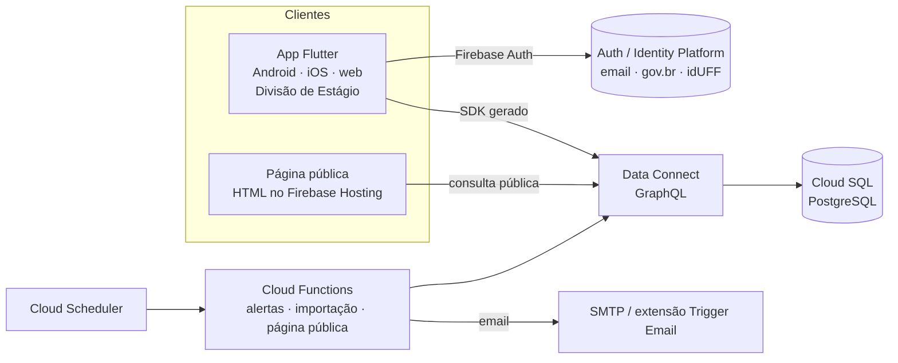

# ARCHITECTURE — Sistema de Estágios UFF (app Flutter + Firebase)

## 1. Arquitetura atual

**Não há código.** Este repositório começa pela documentação (07/10/2026).

A referência funcional é a versão Django ([estudio-max/estagio-da-uff](https://github.com/estudio-max/estagio-da-uff)): modelo de dados, regras, importação, alertas, painel e 110 testes. Sempre que este documento diz "como no Django", a fonte da verdade é o código e os testes de lá.

## 2. Arquitetura proposta

Depende de D23 (banco) e D24 (página pública). Abaixo está a **recomendação** do `docs/DECISAO-PLATAFORMA.md`: opção B, Firebase Data Connect + página pública em HTML.

| Peça | Responsabilidade | Equivalente no Django |
|---|---|---|
| App Flutter | Cadastro de concedentes, convênios e etapas; painel com gráficos; alertas | Admin do Django + painel |
| Firebase Auth | Login da Divisão; gov.br/idUFF via OIDC (Identity Platform) | Login do admin |
| Data Connect + Cloud SQL | Esquema relacional, consultas e mutações com autorização por operação (`@auth`) | Modelos + ORM + constraints |
| Cloud Functions (TypeScript) | Alerta diário, importação do XML do Drupal, geração da página pública | Comandos `enviar_alertas_vencimento`, `importar_convenios_drupal` |
| Firebase Hosting | Página pública em HTML (indexável, acessível) e o app Flutter web | Views públicas + templates |

**Região:** `southamerica-east1` (São Paulo) para Cloud SQL, Functions e Data Connect.

## 3. Modelo de dados

Igual ao do Django (ver o `ARCHITECTURE.md` de lá):
- **Concedente:** documento (CPF/CNPJ, nulo só em importado), razão social, nome fantasia, tipo (9 tipos), UF, cidade, ramo, email.
- **Convênio:** concedente, número, processo SEI, Resolução CEP (+ link), objeto, minuta, origem, início, fim, situação, observações internas, `finalizado_em`, `id_drupal`.
- **EtapaConvenio**, **AlertaVencimento** e o histórico de alterações.

Na opção B, cada modelo vira um `type` do esquema GraphQL do Data Connect, e as constraints vão para o PostgreSQL:
- número de convênio único quando preenchido;
- fim da vigência depois do início;
- convênio finalizado precisa de número e datas;
- alerta único por (convênio, fim da vigência, antecedência).

**Se D23 escolher Firestore (opção A):**

| Coleção | Documento | Observação |
|---|---|---|
| `concedentes/{id}` | dados da concedente | `documento` único garantido por coleção índice `documentos/{cpfOuCnpj}` em transação |
| `convenios/{id}` | dados do convênio + **cópia** de nome, tipo, UF e cidade da concedente | desnormalizado para a página pública e os filtros; Function mantém a cópia em sincronia |
| `convenios/{id}/etapas/{id}` | etapa | subcoleção |
| `convenios/{id}/alertas/{antecedencia_fim}` | aviso enviado | o id do documento garante a unicidade |
| `estatisticas/painel` | contadores do painel | **não criada (1e):** o painel é calculado na hora pela Function `painelConvenios`; vira cache só se o volume de leituras pesar |

"Vigência" (vigente, vencido, a iniciar) continua **derivada** das datas (RN02), calculada no app e nas Functions, nunca gravada.

**Como a 1a ficou implementada (opção A):**
- `concedentes/{id}`, `convenios/{id}` (com `concedente_nome` copiado), `convenios/{id}/etapas/{id}` e `convenios/{id}/historico/{id}`. Datas em texto ISO (`aaaa-mm-dd`).
- **Histórico (RF08):** o app grava o registro na mesma operação em lote da alteração. As regras exigem `por == uid` e `em == request.time` e proíbem editar ou apagar o registro. D17 (a): quem, quando e quais campos, sem o valor anterior.
- **Regras (RN04):** só o papel `divisao` lê e escreve; ninguém exclui. As regras barram as invariantes estruturais (fim depois do início, finalizado exige número e datas, listas fechadas). O dígito verificador (RN03) e a vigência máxima (RN07) ficam no domínio Dart, com testes.
- **Dívida conhecida:** a unicidade de `numero` e de `documento` é checada no app antes de gravar, sem transação; duas pessoas gravando o mesmo número ao mesmo tempo poderiam duplicar. Garantia total: coleção-índice (ver acima), a fazer se virar problema.
- **Dívida conhecida:** `concedente_nome` é atualizado pelo app ao editar a concedente; a Function de sincronia fica para depois.

**Como a 1b ficou implementada (importação do Drupal, RF07):**
- **Onde:** `functions/src/importacao.ts` (leitura do XML e regras, sem Firestore), `importacaoFirestore.ts` (lê o estado e grava) e a Function chamável `importarConveniosDrupal` (`{ xml, simular }`, só com a claim `divisao`, devolve as contagens e o CSV). Para desenvolvimento, `importarCli.js` faz o mesmo e só aceita o emulador. No app, `lib/telas/importacao.dart` (item "Importar convênios" do menu do `Home`) escolhe o arquivo com o `file_picker`, simula, mostra as contagens, salva o CSV e só então grava, com confirmação; o cliente espera até 9 minutos, como a Function.
- **Porta do Django** (`convenios/importacao.py`), com os mesmos casos de teste: ano de 2 dígitos é 20aa; rejeita sem número, sem datas, término não posterior ao início, documento com dígito inválido e número já usado por outro convênio (do Drupal ou do app); avisa tipo sem correspondência (D11, vira "Outros"), UF inválida (fica em branco), vigência acima de 5 anos e concedente sem CNPJ (D20, agrupada pelo nome sem diferenciar caixa). O convênio entra como finalizado, com `finalizado_em` nulo (D19).
- **Idempotência:** o convênio importado tem id `drupal-<nó>` e o campo `id_drupal`; a concedente é achada pelo `documento` ou, sem ele, pelo nome. Reimportar o mesmo arquivo não grava nada; o que mudou é mesclado, preservando o que só existe no app (minuta, origem, nome fantasia, etapas).
- **Lotes:** o estado inteiro é lido uma vez e o plano é calculado em memória; as escritas de cada registro vão no mesmo lote (até 450 operações), então um registro entra inteiro ou não entra. Se um lote falhar, rodar de novo completa.
- **Histórico (RF08):** `importado` ao criar e `reimportado` (com os campos) ao atualizar, com o autor da chamada. Concedente renomeada pela importação atualiza a cópia do nome nos convênios dela.
- **Diferenças em relação ao Django:** data fora do formato `dd/mm/aa` é rejeitada com o motivo (lá derrubava a importação); registro rejeitado não deixa aviso no relatório. HTML cru dentro de um campo vira texto (lá se perdia).

**Como ficou a importação das planilhas da Divisão (RF07, D8, D28):**
- **Onde:** `functions/src/planilhas.ts` (leitura das planilhas com o `exceljs`, que não executa as macros do `.xlsm`), `importacaoPlanilhas.ts` (regras e planejamento, sem Firestore) e a Function chamável `importarConveniosPlanilhas` (`{ arquivos: [{ nome, conteudo em base64 }], simular }`, só com a claim `divisao`, até 7 MB). A gravação reaproveita `gravarPlano` da 1b (lotes e histórico), com ações próprias no histórico: `importado_planilha` e `reimportado_planilha` (o app mostra "importou das planilhas da Divisão"). No app, a mesma tela da 1b (`lib/telas/importacao.dart`), com a fonte "planilhas": aceita várias, simula, mostra as contagens por situação e o relatório.
- **Leitura:** abas "Privados AAAA" e "Convênios AAAA" de 2022 em diante; o cabeçalho é a primeira linha com a coluna CNPJ, e as colunas são achadas pelo nome sem acento nem caixa (os três formatos reais estão em `planilhasFicticias.ts`, usado nos testes). Linhas ocultas por filtro entram. Datas do Excel, número de série ou `dd/mm/aaaa`.
- **Sem porta do Django:** lá não havia importação das planilhas; as regras são as da D28, cada uma com teste.
- **Estado final, não linha a linha:** o planejamento aplica as linhas em memória (da aba mais antiga para a mais nova) e grava só a diferença entre o estado final e o inicial. A concedente que aparece em várias linhas é gravada uma vez, com o dado mais recente; importar de novo o mesmo arquivo não grava nada. A concedente nova vai no mesmo lote do primeiro convênio dela.
- **Ids:** convênio novo com código tem id `planilha-pr-123-2026`; sem código, id gerado. A reimportação acha o convênio pelos dados (D28 b), não pelo id.
- **Invariantes das regras do Firestore** garantidas no planejamento (o Admin SDK não passa pelas regras, mas a Divisão precisa conseguir editar depois): finalizado sempre tem número e datas, fim depois do início, listas fechadas.

**Como a 1d ficou implementada (alertas de vencimento, RF05):**
- **Onde:** `functions/src/alertas.ts` (regras, sem Firestore nem SMTP), `alertasFirestore.ts` (lê e grava; envio por SMTP com o `nodemailer`) e a Function agendada `enviarAlertasVencimento` (todo dia às 07h, fuso de Brasília). No app, o filtro "vence em" (30, 90, 180 e 365 dias) na lista e a seção "Alertas de vencimento enviados" no detalhe do convênio.
- **Porta do Django** (`convenios/alertas.py`), com os mesmos casos de teste: só convênio vigente; a faixa é a menor antecedência já alcançada; um aviso por (convênio, fim da vigência, antecedência), com id `<antecedência>_<fim>` em `convenios/{id}/alertas`; aviso mais urgente já enviado cobre as faixas maiores (job parado vários dias manda só o mais urgente); renovar o fim reinicia os avisos; um único e-mail por dia, ordenado pelo vencimento; sem alertas, nenhum e-mail; sem `DIVISAO_EMAIL`, falha.
- **Leitura:** só os convênios com `fim_vigencia` entre hoje e hoje + a maior antecedência (filtro de um campo, sem índice composto); a situação e o início são conferidos em memória.
- **Configuração:** `DIVISAO_EMAIL`, `ALERTA_ANTECEDENCIAS_DIAS` (padrão 365,180,90,30, D3), `EMAIL_REMETENTE` e `APP_URL` em `functions/.env.<projeto>`; a URL do SMTP (com a senha) no segredo `SMTP_URL` do Secret Manager. Sem o segredo, o deploy das Functions pede para criá-lo. No emulador, sem SMTP, o e-mail sai no log.
- **Regras do Firestore:** a Divisão lê `alertas`; ninguém grava pelo app (só o Admin SDK).
- **Diferenças em relação ao Django:** lá o registro e o envio ficavam na mesma transação; aqui o e-mail sai primeiro e o registro vem depois. Se o envio falha, nada é marcado (igual); se o registro falha depois do envio, o aviso se repete no dia seguinte (repetido, nunca perdido). O e-mail traz um link para o app, não para o convênio, porque o app não tem endereço por tela; o número do convênio serve para a busca.
- **Em aberto:** D3 (antecedências e quem recebe) e D21 (primeira execução em produção: por enquanto é a opção (a), como no Django, com todos os avisos num e-mail só).

**Como a 1e ficou implementada (painel, RF06, MS05 parcial):**
- **Onde:** `functions/src/painel.ts` (cálculo, sem Firestore), `painelFirestore.ts` (leitura) e a Function callable `painelConvenios`; no app, `lib/telas/painel.dart`, a seção "Painel" do menu.
- **Porta do Django** (`convenios/painel.py` e o template), com os mesmos casos de teste: convênios por situação (RN02); vigentes que vencem em 30, 90 e 180 dias; vigentes por tipo de concedente, com todos os tipos; tempo de tramitação (média e mediana) dos finalizados no último ano, contado da primeira etapa registrada ou, sem etapas, do cadastro; os 10 convênios em tramitação há mais tempo, que abrem o detalhe.
- **Por que numa Function e não no app:** a data do cadastro é a criação do documento (`createTime`), que só o Admin SDK enxerga, e a primeira etapa de cada convênio sai de uma só consulta (`collectionGroup('etapas')`), sem abrir as regras para consultas de grupo. Cada abertura do painel lê todos os convênios, as concedentes (só o tipo) e as etapas: alguns milhares de leituras com os dados das planilhas. Se pesar, guardar o resultado em `estatisticas/painel`.
- **Calculado na hora**, não por agendamento: as contagens batem com o banco (critério de aceitação §6), inclusive logo depois de uma edição ou importação.
- **Acesso:** só o papel `divisao` (premissa da D4); a Function recusa os demais.
- **Limite conhecido:** convênio importado não tem etapas nem data de finalização (D19); o finalizado importado fica fora da média, e o em tramitação conta da data da importação. O relatório da importação das planilhas aponta os parados há mais de um ano (D28).
- **Gráficos:** barras proporcionais nas contagens por situação e por tipo, sem biblioteca de gráficos.

**Como a 1c ficou implementada (página pública, RF03, RF04, RN01, RN08):**
- **Onde:** `functions/src/paginaPublica.ts` (regras e HTML, sem Firestore), `paginaPublicaFirestore.ts` (leitura) e a Function HTTP `paginaPublica`. O Hosting encaminha `/convenios` e `/convenios/**` para ela (`firebase.json`); o resto continua no app Flutter web (D24: HTML para o público, Flutter só para a Divisão).
- **Porta do Django** (`convenios/views.py` e os templates), com os mesmos casos de teste: só convênio finalizado vigente ou a iniciar (este com o selo "A partir de", D18); busca por nome, nome fantasia, número, processo e CNPJ (sem diferenciar caixa); filtros por tipo e UF; 50 por página, mantendo os filtros; detalhe de convênio que não é público dá 404, sem revelar que existe; CPF não aparece nem é buscável (RN08); todo texto cadastrado é escapado. Mesmo visual (paleta do `tema.css` do Django).
- **Leitura:** os convênios com `fim_vigencia` a partir de hoje (filtro de um campo, sem índice composto) e as concedentes deles, por `getAll`. A situação e o início são conferidos em memória. A leitura copia **só os campos públicos**: o que é interno não chega ao HTML nem por engano.
- **Atualização (RN01):** o HTML é gerado a cada pedido e fica em cache por até 10 minutos no Hosting (`s-maxage=600`) e 5 no navegador; convênio finalizado aparece sem passo manual.
- **Campos públicos:** premissa da D2 (os da página atual do site). Ficam fixos no código; a marcação por campo (RF03) espera a PROGRAD.
- **Diferenças em relação ao Django:** os endereços são `/convenios` e `/convenios/<id do documento>` (lá a lista ficava na raiz); a busca roda em memória, o que basta para as centenas de convênios vigentes.
- **Fora da 1c:** o acesso das concedentes com login (D27) fica para um incremento próprio, depois de a PROGRAD confirmar a premissa.

## 4. Autenticação e autorização

- **Divisão de Estágio:** papel `divisao` via *custom claim* do Firebase Auth, atribuído por Function administrativa. Só ela escreve (RN04).
- **Usuários internos (D26, 28/10/2026):** login com Google; o servidor só aceita e-mail verificado terminado em `@id.uff.br`. O papel vem de um **grupo do Google** (Participante, Administrador, Proprietário). Uma Function consulta o grupo no login e grava a *custom claim* correspondente; as regras do Firestore só olham a claim. Hoje a claim é `divisao`; o nome final dos papéis sai da D26. Depende do plano Blaze e de a conta de serviço poder ler os membros do grupo. Administradores do grupo: Cosme e João Fanara; Proprietário inicial: Cosme (04/11/2026); Participantes a indicar. Enquanto isso, a demonstração segue com e-mail/senha e a claim `divisao`.
- **Como o grupo é lido (11/11/2026):** a Function `sincronizarPapel` (callable) recebe o login do Google, exige e-mail verificado `@id.uff.br`, consulta o papel da pessoa no grupo `estagios.uff@id.uff.br` pela Directory API (`members.get`) e grava a claim `divisao`. A delegação em todo o domínio usa a conta de serviço **já autorizada** no Google Admin com o escopo de leitura de membros, como a equipe confirmou; a Function a representa **sem chave**, assinando o JWT pela IAM Credentials (permissão de criador de token). O administrador representado deve ser uma **conta dedicada** ao sistema. Se o grupo não puder ser consultado, nada é concedido nem revogado. Implementação no PR 6 e roteiro em `docs/CONFIGURAR-GRUPO.md`.
- **Usuários externos (D27, premissa de 04/11/2026):** login por e-mail com link (Firebase Auth). A Divisão cadastra os e-mails dos representantes na concedente; no primeiro acesso uma Function confere a lista e grava a claim `concedente_id`. As regras só deixam ler os convênios daquela concedente, sem escrita. O Firestore não esconde campos, então **antes de abrir o acesso externo** as observações internas e o histórico vão para um documento à parte (`convenios/{id}/internos/dados`), que a regra nega ao externo. O externo nunca tem a claim `divisao`.
- **Público:** sem login; acessa só a consulta pública, que devolve os campos públicos (RF03) e **nunca** o CPF (RN08).
- **Opção B:** autorização em cada operação do Data Connect (`@auth(expr: "auth.token.divisao == true")`).
- **Opção A:** Firestore Security Rules, com **testes de regras** no emulador (Fase 0).
- **Login externo:** gov.br/idUFF entram como provedores OIDC no Identity Platform (D6).

## 5. Transversais

- **Ambientes:** dois projetos Firebase, `dev` (`estagiosuff`) e `prod` (a criar). Desenvolvimento local no **Firebase Emulator Suite**, sem tocar na nuvem.
- **Segredos:** nada no repositório. O `firebase_options.dart` de prod é gerado no CI; credenciais de SMTP ficam no Secret Manager.
- **Testes:**
  - `flutter test`: unidade e widgets;
  - testes de integração contra o emulador;
  - testes das regras ou das operações `@auth`;
  - testes das Functions (Jest).
- **Paridade com o Django:** as regras portadas (CPF/CNPJ alfanumérico, vigência derivada, 5 anos, alertas sem repetição, importação) reutilizam os **mesmos casos de teste** de lá.
- **Visual do app (24/11/2026):** identidade da pasta 0-Identidade da Divisão, no lugar da paleta do Cuba do Django (A13), que fica só na página pública da 1c. Azul do logo `#2056AE` nas ações, marinho `#12294F` no menu e nos títulos, fundo `#F5F8FC`, cartões brancos com borda e raio de 16px; Inter no texto e Exo 2 nos títulos, embutidas em `assets/fonts` (licença OFL). Logos em `assets/identidade`: o EstágiosLogo na entrada, o EstágiosÍcone no menu e como ícone do app, e o da PROGRAD no rodapé da entrada. Tema em `lib/telas/tema.dart`; selos e componentes comuns em `lib/telas/comum.dart`. Na tela larga (a partir de 900px) o `Home` tem menu lateral; no celular, barra de seções embaixo. Cada seção (Convênios, Concedentes, Painel) tem o próprio `Navigator`, então o menu continua visível ao abrir um convênio, e o painel só chama a Function quando é aberto.
- **LGPD:** dados reais só em `prod`. `dev` e testes usam dados fictícios. O XML do Drupal nunca entra no repositório.

## 6. Decisões

| # | Decisão | Status |
|---|---|---|
| B1 | Repositório novo; a versão Django é a referência funcional e de testes | Decidida em 07/10/2026 |
| B2 | Flutter para o app da Divisão (Android, iOS, web) | Pedido do cliente |
| B3 | Banco: Firestore (opção A). Data Connect fica como alternativa a reavaliar antes da Fase 3 | Decidida e confirmada pela PROGRAD em 27/10/2026 (D23) |
| B7 | Projeto Firebase `dev` = `estagiosuff` (já existente, conta cosmefc@id.uff.br); desenvolvimento local no emulador com o projeto fictício `demo-estagios-uff`; `prod` ainda não criado | Proposta |
| B4 | Página pública em HTML no Hosting, não em Flutter web | Decidida em 28/10/2026 (D24) |
| B5 | Functions em TypeScript (melhor suporte no Firebase e nos emuladores) | Proposta |
| B6 | Região `southamerica-east1` | Proposta |

## 7. Riscos e débitos

- Duas bases de código (Django e Flutter) até a migração terminar: definir com o cliente qual delas a Divisão usa durante a transição.
- O Identity Platform e o Cloud SQL são pagos; o dono da conta Google Cloud é o Cosme (cosmefc@id.uff.br), definido em 28/10/2026 (D25).
- A equipe ainda não domina Dart/Flutter: a Fase 0 inclui um protótipo pequeno antes de portar regras.
