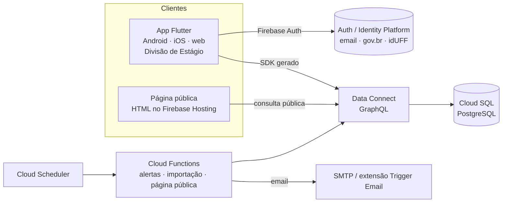

# ARCHITECTURE — Sistema de Estágios UFF (app Flutter + Firebase)

## 1. Arquitetura atual

**Não há código.** Este repositório começa pela documentação (07/10/2026).

A referência funcional é a versão Django ([estudio-max/estagio-da-uff](https://github.com/estudio-max/estagio-da-uff)): modelo de dados, regras, importação, alertas, painel e 110 testes. Sempre que este documento diz "como no Django", a fonte da verdade é o código e os testes de lá.

## 2. Arquitetura proposta

Depende de D23 (banco) e D24 (página pública). Abaixo está a **recomendação** do `docs/DECISAO-PLATAFORMA.md`: opção B, Firebase Data Connect + página pública em HTML.

| Peça | Responsabilidade | Equivalente no Django |
|---|---|---|
| App Flutter | Cadastro de concedentes, convênios e etapas; painel com gráficos; alertas | Admin do Django + painel |
| Firebase Auth | Login da Divisão; gov.br/idUFF via OIDC (Identity Platform) | Login do admin |
| Data Connect + Cloud SQL | Esquema relacional, consultas e mutações com autorização por operação (`@auth`) | Modelos + ORM + constraints |
| Cloud Functions (TypeScript) | Alerta diário, importação do XML do Drupal, geração da página pública | Comandos `enviar_alertas_vencimento`, `importar_convenios_drupal` |
| Firebase Hosting | Página pública em HTML (indexável, acessível) e o app Flutter web | Views públicas + templates |

**Região:** `southamerica-east1` (São Paulo) para Cloud SQL, Functions e Data Connect.

## 3. Modelo de dados

Igual ao do Django (ver o `ARCHITECTURE.md` de lá):
- **Concedente:** documento (CPF/CNPJ, nulo só em importado), razão social, nome fantasia, tipo (9 tipos), UF, cidade, ramo, email.
- **Convênio:** concedente, número, processo SEI, Resolução CEP (+ link), objeto, minuta, origem, início, fim, situação, observações internas, `finalizado_em`, `id_drupal`.
- **EtapaConvenio**, **AlertaVencimento** e o histórico de alterações.

Na opção B, cada modelo vira um `type` do esquema GraphQL do Data Connect, e as constraints vão para o PostgreSQL:
- número de convênio único quando preenchido;
- fim da vigência depois do início;
- convênio finalizado precisa de número e datas;
- alerta único por (convênio, fim da vigência, antecedência).

**Se D23 escolher Firestore (opção A):**

| Coleção | Documento | Observação |
|---|---|---|
| `concedentes/{id}` | dados da concedente | `documento` único garantido por coleção índice `documentos/{cpfOuCnpj}` em transação |
| `convenios/{id}` | dados do convênio + **cópia** de nome, tipo, UF e cidade da concedente | desnormalizado para a página pública e os filtros; Function mantém a cópia em sincronia |
| `convenios/{id}/etapas/{id}` | etapa | subcoleção |
| `convenios/{id}/alertas/{antecedencia_fim}` | aviso enviado | o id do documento garante a unicidade |
| `estatisticas/painel` | contadores do painel | recalculados por Function agendada: o Firestore não agrega por UF ou por ano com eficiência |

"Vigência" (vigente, vencido, a iniciar) continua **derivada** das datas (RN02), calculada no app e nas Functions, nunca gravada.

## 4. Autenticação e autorização

- **Divisão de Estágio:** papel `divisao` via *custom claim* do Firebase Auth, atribuído por Function administrativa. Só ela escreve (RN04).
- **Público:** sem login; acessa só a consulta pública, que devolve os campos públicos (RF03) e **nunca** o CPF (RN08).
- **Opção B:** autorização em cada operação do Data Connect (`@auth(expr: "auth.token.divisao == true")`).
- **Opção A:** Firestore Security Rules, com **testes de regras** no emulador (Fase 0).
- **Login externo:** gov.br/idUFF entram como provedores OIDC no Identity Platform (D6).

## 5. Transversais

- **Ambientes:** dois projetos Firebase, `estagios-uff-dev` e `estagios-uff-prod`. Desenvolvimento local no **Firebase Emulator Suite**, sem tocar na nuvem.
- **Segredos:** nada no repositório. O `firebase_options.dart` de prod é gerado no CI; credenciais de SMTP ficam no Secret Manager.
- **Testes:**
  - `flutter test`: unidade e widgets;
  - testes de integração contra o emulador;
  - testes das regras ou das operações `@auth`;
  - testes das Functions (Jest).
- **Paridade com o Django:** as regras portadas (CPF/CNPJ alfanumérico, vigência derivada, 5 anos, alertas sem repetição, importação) reutilizam os **mesmos casos de teste** de lá.
- **Visual:** tema claro, paleta do Cuba (`#7366ff`, fundo `#f7f8f9`, cartões brancos com raio de 15px, fonte Rubik), como no Django (A13).
- **LGPD:** dados reais só em `prod`. `dev` e testes usam dados fictícios. O XML do Drupal nunca entra no repositório.

## 6. Decisões

| # | Decisão | Status |
|---|---|---|
| B1 | Repositório novo; a versão Django é a referência funcional e de testes | Decidida em 07/10/2026 |
| B2 | Flutter para o app da Divisão (Android, iOS, web) | Pedido do cliente |
| B3 | Banco: Data Connect (PostgreSQL) recomendado; Firestore alternativo | **Pendente — D23** |
| B4 | Página pública em HTML no Hosting, não em Flutter web | **Pendente — D24** |
| B5 | Functions em TypeScript (melhor suporte no Firebase e nos emuladores) | Proposta |
| B6 | Região `southamerica-east1` | Proposta |

## 7. Riscos e débitos

- Duas bases de código (Django e Flutter) até a migração terminar: definir com o cliente qual delas a Divisão usa durante a transição.
- O Identity Platform e o Cloud SQL são pagos; alguém precisa ser o dono da conta Google Cloud (D25).
- A equipe ainda não domina Dart/Flutter: a Fase 0 inclui um protótipo pequeno antes de portar regras.
